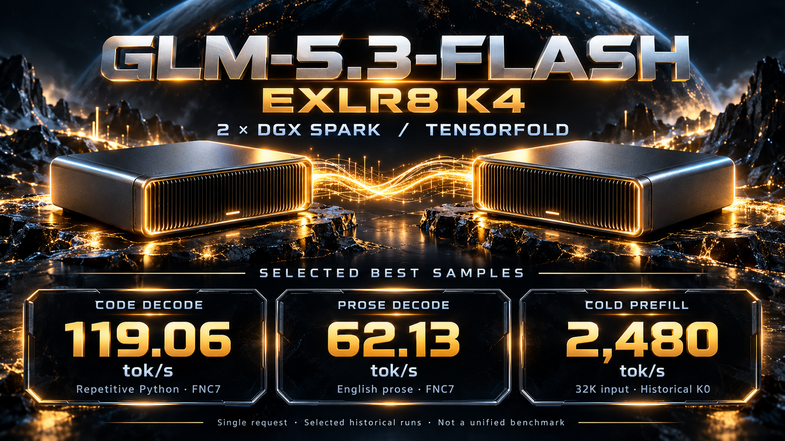

# GLM-5.3-Flash EXLR8 K4 · TensorFold · 2× DGX Spark

**Two Sparks. Selected decode samples: 119 tok/s code and 62 tok/s prose. Updated cold prefill: 1,895 tok/s at 32K and 1,855 tok/s at 197K (2026-10-19).**

A source and configuration snapshot of our GLM-5.3-Flash EXLR8 K4 deployment: dual GB10, TP2 over RoCE, DFlash2 speculation, an OpenAI-compatible API, image input, and a shared FP8 KV pool. The target model retains its source K4 / MXFP8 / FP8 formats, with **no additional Q4 MSE or output-head weight requantization**. The drafter uses MSE Q4.

> **Updated 2026-10-19 (Asia/Taipei):** the packaged source and defaults now include the retained BF16 prefill optimizations. The new prefill figures are single cold-input measurements of the retained running deployment, not three-run averages or a fresh startup of this recipe. Decode figures remain selected historical samples published on 2026-10-18; decode was not remeasured. No benchmark or model reload was performed while preparing this repository update.

[Performance](#performance) · [Quick start](#quick-start) · [Model sources](#weights-and-base-image) · [Validation](docs/VALIDATION.md) · [Licenses](#quality-licenses-and-upstream)

## Performance

**Hardware:** 2× NVIDIA DGX Spark / GB10, 128 GB unified memory per node, ConnectX-7 RoCE. All figures below are for a single request.

### Current cold prefill — measured 2026-10-19

FNC7 enabled, source-format target weights, BF16 long-prefill computation, zero cached input tokens, one isolated request per row:

| Workload | Actual input tokens | Prefill throughput | Time to first token | Measurement date |
|---|---:|---:|---:|---|
| **Cold prefill · 32K** | 32,829 | **1,894.71 tok/s** | **17.396 s** | **2026-10-19** |
| **Cold prefill · 197K** | 196,663 | **1,854.57 tok/s** | **106.449 s** | **2026-10-19** |

The retained settings are `bf16_prefill=3`, `prefill_pieces=1`, and `prefill_schedule=2`. Atomic expert reduction, diagnostic profiling, and long-prefill MXFP8 activation quantization remain **off**. These are single measurements, not averages. The 2,000 tok/s experiment target was not reached.

Earlier **same-load paired measurements on 2026-10-19** established the main BF16 configuration / cuBLAS / HC batching improvement:

| Actual input tokens | Original path | BF16 + cuBLAS + one HC piece | Improvement | TTFT before → after |
|---|---:|---:|---:|---:|
| 32,832 | 1,728.02 tok/s | 1,875.73 tok/s | **+8.55%** | 19.061 → 17.557 s |
| 196,666 | 1,675.40 tok/s | 1,825.44 tok/s | **+8.95%** | 117.754 → 108.114 s |

A subsequent same-load comparison of whole-row projection scheduling added approximately **1.02% / 1.09%** at 32K / 197K. The final retained measurements are in the first table; these separate experiments are not combined into a synthetic speedup. No extra weight or activation quantization was added by this update. Local projection checks reached a maximum relative L2 difference of **0.0147%**; changed reduction order can change generated text, and this is not a model-quality score.

### Selected historical decode samples — published 2026-10-18

| Workload | Selected best sample | Configuration and context |
|---|---:|---|
| **Code decode** | **119.06 tok/s** | FNC7; 512 output tokens; seed 42; repetitive Python functions with copy-draft |
| **Prose decode** | **62.13 tok/s** | FNC7; 512 output tokens; seed 44; English technical prose |
| Algorithmic code decode | 64.52 tok/s | FNC7; 512 output tokens; seed 42; interval-sweep algorithm |

Code and prose use the retained `verify8 + expert_order=2 + draft_noise=1.0` path. These are measurements of earlier images using that path, **not new decode measurements of this update or acceptance results from rebuilding this repository**. Repetitive code does not represent general programming workloads. The retained prose configuration averaged approximately **57.82 tok/s across three seeds**.

The original 2026-10-18 release also highlighted historical K0 cold-prefill samples of **2,302 / 2,480 tok/s at 8K / 32K**. Those use different engine timing boundaries and are **not the current FNC7 prefill results**; their provenance remains in [benchmark notes](docs/BENCHMARKS.md).

Sampling: temperature 1.0, top-p 0.95, top-k 20, thinking disabled; prefill requests generate 32 tokens with seed 42. Decode throughput is `(output tokens − 1) / engine decode seconds`; prefill throughput is `uncached input tokens / engine prefill seconds`. TTFT is reported separately. See [dated prefill results and precision checks](docs/PREFILL_20261019.md), [prefill evidence](evidence/prefill-20261019.json), [historical evidence](evidence/benchmarks.json), and [prompts](evidence/prompts.json).

## What's included

- **EXLR8 K4 routed experts:** E4M3 codebooks with EXL3-compatible FP16 MMA. This is a TensorFold integration, not the complete gr8-native expert engine.
- **Source MXFP8 input projections:** native block-scaled MMA for up to 32 rows; expanded BF16 computation for long prefill. The experimental long-prefill MXFP8 path is disabled.
- **BF16 long-prefill tuning (2026-10-19):** 14 exact-shape Triton configurations, an 18-shape BF16 cuBLAS whitelist with FP32 accumulation, and whole-row projection / HC batching. Existing decompression storage is reused; there is no new resident expanded-weight copy. Request-boundary switches are synchronized across TP ranks and included in prefix-cache tags.
- **Source K4 dense projections:** direct compressed reads for small row counts and lossless BF16 fallback storage for larger inputs. Decode prefetch excludes the prefill fallback representation.
- **FNC7 verification:** `verify8` covers 2–8-row verification; short-context graphs reduce unnecessary index work while retaining the long-context fallback. Expert ordering is enabled.
- **DFlash2 defaults:** `fnc7:0.3`, beta 2, noise 1.0, the official day-31 MSE drafter, and copy-draft. Only the pinned day-31 checkpoint is required. The package includes the existing startup fix that skips missing retired day-27/day-28 files.
- **Shared cache:** the running deployment has **1,699,840 FP8 KV tokens**, four slots, a configured per-slot context limit of **1,048,576**, and 32 prefix snapshots capped at 3 GiB. The 1M context limit has not undergone a full-length stress test.
- **Vision on rank 0:** 2,048 tokens per image, up to 50 images. The visual tower reuses independently retained BF16 components from the original NVFP4 checkpoint. Video support has not been validated.

The 2026-10-19 deployment has already skipped the removed day-27/day-28 draft banks; the earlier 1.265 GiB-per-node residency note no longer applies. Its actual pool remains **1,699,840 tokens**. A new deployment must report its capacity from health output rather than assuming the same allocation.

## Quick start

Run on the first Spark. Both nodes need Docker, NVIDIA Container Toolkit, working RoCE, and existing passwordless SSH access. The scripts use the existing network and leave unrelated deployments alone.

```bash
git clone https://github.com/UniRound-Tec/GLM-5.3-Flash-EXLR8-K4-TensorFold-2x-DGX-Sparks.git
cd GLM-5.3-Flash-EXLR8-K4-TensorFold-2x-DGX-Sparks

bash quickstart.sh init
# Edit config/local.json:
# - original K4 model directories on both nodes
# - pinned day-31 draft snapshot directories
# - rank-0 vision source, SSH peer, and RoCE interfaces
# Set api_key_file to reuse an existing key, or leave it empty to generate one.

# Original lab environment: reuse the existing image for an offline build.
bash quickstart.sh build --base-image glm-mxprefill:20261018
bash quickstart.sh prepare
bash quickstart.sh sync-image
bash quickstart.sh start
bash quickstart.sh status
```

The local `glm-mxprefill:20261018` base image is not published by this repository. For a new machine, use the pinned public base and dependency preparation described below and in [deployment instructions](docs/DEPLOYMENT.md).

Initial startup can take several minutes and may compile CUDA extensions. If an existing service owns a required port, `start` exits without stopping it. Arrange its shutdown beforehand or configure separate ports and container names. Failed containers are retained for diagnosis. `bash quickstart.sh stop` stops only containers owned by this recipe.

| API setting | Default |
|---|---|
| OpenAI-compatible base URL | `http://<head>:8888/v1` |
| Model ID | `GLM-5.3-Flash-EXLR8-K4` |
| API key file | `private/api-key` inside the head node's configured data directory |
| Internal backend | `127.0.0.1:8889` |

Keys are read from protected files and are not printed by setup or included in the repository or image.

### Weights and base image

Model weights are **not included**. `prepare` creates metadata views and symlinks; it does not download or requantize weights. Required source files must already exist on each node. LAN copies can use resumable transfers such as `rsync --partial --append-verify`.

| Component | Pinned source |
|---|---|
| K4 target | [KindlingAI model card](https://huggingface.co/kindlingai/glm-5.3-flash-exlr8-k2-k3-k4), revision `3117e3b85744ca91c49fcbe95b46c33f31091829`; dense files, K4 experts and indexes, including MTP metadata |
| Active drafter | [IncoAI DFlash2](https://huggingface.co/incoai/GLM-5.3-Flash-DFlash2), revision `bf582e4eacc1810f76656d1811693ff6c6737d2a` |
| Visual components | Existing [LIL NVFP4 CSF-QAD](https://huggingface.co/local-inference-lab/GLM-5.3-Flash-NVFP4-CSF-QAD) checkpoint/view; 347 BF16 visual tensors, reused read-only without requantization |

Set `model_dir` to the original Kindling snapshot. `draft_dir` must point to the snapshot directory named after the pinned day-31 revision; retired day-27/day-28 downloads are unnecessary. Set `vision_dir` to a retained checkpoint/view containing the configuration, processor, safetensors index, and independent visual shard. The deleted NVFP4 language-model weights are not required.

The Dockerfile also pins a public Mia base image by digest. For the default offline build, that image and the dependencies in `requirements-runtime.txt` must already be available locally; otherwise the build fails explicitly. On a new machine, prepare the base image and dependencies first as described in [deployment instructions](docs/DEPLOYMENT.md). **A fresh installation from the public base and a new dual-GPU model startup have not been revalidated for this package.**

Downloads must follow the operator's authorized network route. The scripts do not modify proxies, FRP, or networking and do not automatically download models or images. Captured ARM64 runtime libraries, corresponding CUDA sources, and optional rebuild instructions are included; see [BUILD](docs/BUILD.md).

## Manual benchmarking

```bash
python3 scripts/benchmark.py --case code --seed 42 --key-file ~/.local/share/glm53-exlr8-recipe/private/api-key --out code.json
python3 scripts/benchmark.py --case prose --seed 44 --key-file ~/.local/share/glm53-exlr8-recipe/private/api-key --out prose.json
python3 scripts/benchmark.py --case prefill32k --seed 42 --key-file ~/.local/share/glm53-exlr8-recipe/private/api-key --out prefill32k.json
python3 scripts/benchmark.py --case prefill197k --seed 42 --key-file ~/.local/share/glm53-exlr8-recipe/private/api-key --out prefill197k.json
```

These commands generate real requests; deployment does not invoke them automatically. Each result retains usage, engine timing, cache information, and generated text. A prefill request with cache hits is not reported as a valid cold-prefill throughput result. The script defaults to the current FNC7 configuration and does not reproduce the historical K0 image.

## Quality, licenses, and upstream

**Model quality and capabilities need further evaluation.** Retaining source weights does not make the model full BF16: source K4/MXFP8/FP8 quantization, existing small-row activation quantization, kernel rounding, and FP8 KV remain. This repository adds no new capability evaluation and does not attribute historical NVFP4 HumanEval results to the current K4 model.

Upstream projects:

- [TensorFold](https://github.com/ashhart/TensorFold)
- [Mia's dual-Spark recipe](https://github.com/MiaAI-Lab/GLM-5.3-Flash-EXL3-2x-DGX-Sparks-TensorFold)
- [KindlingAI gr8](https://github.com/kindlingai/gr8)
- [Atlas](https://github.com/Enntity/atlas)
- [B12X](https://github.com/local-inference-lab/b12x)

Pinned revisions are recorded in [sources.lock.json](sources.lock.json). The combined code is provided under **AGPL-3.0-only**, with original Apache-2.0/MIT terms retained for their respective upstream files. The pinned K4 weights include an MIT license; DFlash2 uses CC BY-NC-ND 4.0; visual components retain the LIL License 1.0 terms. Model licenses are independent of this repository's code license. See [THIRD_PARTY_NOTICES](THIRD_PARTY_NOTICES.md).

**Visual-source attribution:** This model is based on [GLM-5.3-Flash-NVFP4-CSF-QAD](https://huggingface.co/local-inference-lab/GLM-5.3-Flash-NVFP4-CSF-QAD) by Local Inference Lab, Inc., a non-profit organization, available at https://huggingface.co/local-inference-lab/GLM-5.3-Flash-NVFP4-CSF-QAD. GLM-5.3-Flash-NVFP4-CSF-QAD is licensed under the Local Inference Lab License, Version 1.0. This recipe reuses only its BF16 visual components; the language model is the Kindling K4 checkpoint listed above.

[Validation scope](docs/VALIDATION.md) · [Local source changes](vendor/MODIFICATIONS.md) · [Benchmark evidence](docs/BENCHMARKS.md) · [Promotional artwork and prompt](assets/README.md)

<details>
<summary>Original launch artwork — 2026-10-18, historical K0 prefill figures</summary>



The artwork preserves the original historical headline. Use the dated tables above for the updated FNC7 prefill results.

</details>
